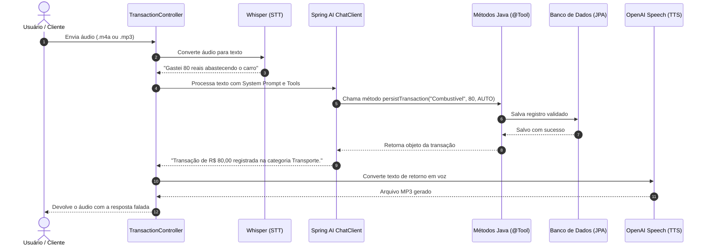

# Projeto Spring AI

Uma API de gerenciamento financeiro desenvolvida em **Java** e **Spring Boot**, integrada ao ecossistema do **Spring AI**. O foco principal deste projeto é processar comandos de voz e texto, interpretar intenções em linguagem natural e executar operações reais no banco de dados usando **Tool Calling** (chamada de funções pelo modelo de IA), devolvendo o resultado tanto em JSON quanto em áudio falado.

Este projeto foi desenvolvido como evolução do desafio prático da trilha de Spring Boot da [Digital Innovation One (DIO)](https://github.com/digitalinnovationone/dio-spring-boot-learning-track).

---

## 🧭 O que o projeto faz

Na prática, a API funciona como um assistente para registro e consulta rápida de despesas do dia a dia. Você pode simplesmente falar ou digitar o que gastou, e a inteligência artificial cuida da categorização e do cadastro no sistema.

O fluxo de processamento funciona assim:

1. **Entrada de voz:** O cliente envia um áudio (por exemplo, falando *"gastei 65 reais na farmácia comprando remédio"*).
2. **Transcrição de áudio (STT):** O modelo **Whisper** da OpenAI converte o áudio em texto.
3. **Interpretação e decisão:** O **ChatClient** (usando o modelo `gpt-4o-mini`) analisa a frase, identifica o valor monetário, a descrição e define a categoria mais adequada.
4. **Execução de regra real (Tool Calling):** Em vez de inventar uma resposta, o modelo chama um método Java real do backend (`persist-transaction`).
5. **Persistência dos dados:** O caso de uso valida os dados e salva a transação no banco de dados via Spring Data JPA.
6. **Resposta em áudio (TTS):** O sistema gera uma mensagem confirmando o cadastro e converte esse texto em fala através do **OpenAI Speech**, retornando um arquivo `.mp3` pronto para reprodução.

Caso prefira não usar áudio, a aplicação também possui um endpoint de chat em texto para testar e interagir diretamente por requisições JSON.



---

## 🛠️ Tecnologias utilizadas

- **Java 25:** Versão utilizada para compilação e execução.
- **Spring Boot 4.0:** Base para endpoints REST, injeção de dependências e configuração.
- **Spring AI (v2.0):**
  - `ChatClient` com suporte a Tool Calling declarativo.
  - `TranscriptionModel` para o Whisper (áudio para texto).
  - `TextToSpeechModel` para síntese de voz (texto para áudio).
  - `@Tool` e `@ToolParam` para expor regras de negócio ao modelo.
- **Spring Data JPA & Hibernate:** Mapeamento objeto-relacional e persistência.
- **H2 Database:** Banco em memória para execução e testes rápidos sem setup prévio.
- **MySQL 9 & Docker Compose:** Perfil configurado para ambiente com banco relacional externo.
- **JUnit 5, AssertJ & Mockito:** Cobertura de testes unitários e de integração.
- **Gradle 9:** Automação de build e gerenciamento de dependências.

---

## 🚀 Como executar a aplicação

### Pré-requisitos
- JDK 25 instalado na máquina.
- Uma chave de API da OpenAI (`OPENAI_API_KEY`) para testar as chamadas reais aos modelos generativos.

### 1. Clonar o projeto
```bash
git clone https://github.com/kauancra08/projeto-spring-ai.git
cd projeto-spring-ai
```

### 2. Configurar a chave da OpenAI (opcional para rodar com H2/testes)
Defina a variável no seu terminal:

- **Windows (PowerShell):**
  ```powershell
  $env:OPENAI_API_KEY="sua-chave-aqui"
  ```
- **Linux ou macOS:**
  ```bash
  export OPENAI_API_KEY="sua-chave-aqui"
  ```

> Se não configurar a chave, a aplicação subirá normalmente com uma chave de fallback local, permitindo rodar a suíte de testes unitários e os endpoints REST tradicionais.

### 3. Rodar a aplicação
O projeto já está configurado com **H2 em memória por padrão**. É só rodar:

```bash
./gradlew bootRun
```
*(No Windows: `.\gradlew.bat bootRun`)*

A aplicação estará pronta em `http://localhost:8080`.

#### (Opcional) Rodar com MySQL via Docker
Caso queira persistir em MySQL:
```bash
docker compose up -d
./gradlew bootRun --args='--spring.profiles.active=mysql'
```

---

## 💡 Melhorias que implementei no projeto

Ao estudar o código base apresentado no curso, decidi adicionar melhorias práticas para tornar a API mais robusta e completa:

1. **Novas ferramentas para a IA (Tool Calling):**
   - **`get-balance-summary`:** Criei uma ferramenta que calcula na hora o total geral de despesas cadastradas, a quantidade de transações, a divisão por categoria e qual categoria teve maior gasto. Assim, o usuário pode perguntar por voz ou texto: *"qual é o meu saldo?"* ou *"onde gastei mais?"*.
   - **`list-all-transactions`:** Adicionei a ferramenta para listagem completa de transações direto pelo agente.

2. **Endpoint de Chat textual (`POST /transactions/ai/chat`):**
   - No projeto original, para testar a IA era obrigatório enviar um arquivo de áudio. Implementei um endpoint JSON para enviar comandos em texto, facilitando testes rápidos no cURL ou Postman.

3. **Validações no Domínio e Tratamento de Erros:**
   - Adicionei regras de negócio na entidade `Transaction` (impedindo valores zerados ou negativos e descrições vazias).
   - Implementei um `GlobalExceptionHandler` (`@RestControllerAdvice`) que captura erros de validação e retorna um JSON padronizado com status 400 em vez de um stacktrace genérico.

4. **Zero-Configuração com H2:**
   - Adicionei suporte ao banco H2 como padrão para que qualquer pessoa que clone o projeto consiga rodar `./gradlew bootRun` ou `./gradlew test` de primeira, sem precisar de Docker ou de um MySQL pré-instalado.

5. **Categorização Semântica Expandida:**
   - Adicionei categorias como `LEISURE`, `UTILITIES`, `EDUCATION` e `OTHER`, refinando o prompt do sistema para orientar o modelo na interpretação do vocabulário brasileiro.

6. **Testes Unitários:**
   - Escrevi testes com Mockito e AssertJ para os casos de uso e testes de controller com MockMvc.

---

## 🧪 Como testar o fluxo principal

### 1. Testar via comando de voz (Áudio ➔ IA ➔ Áudio)
O repositório já conta com áudios de teste reais em `src/test/resources/audio/`:

```bash
curl -X POST "http://localhost:8080/transactions/ai" \
  -H "Content-Type: multipart/form-data" \
  -F "file=@src/test/resources/audio/recording-1.m4a" \
  --output resposta.mp3
```
*O retorno será um arquivo `resposta.mp3` com a voz gerada pela IA confirmando a ação.*

### 2. Testar via texto com Tool Calling
Registrar um gasto em linguagem natural:
```bash
curl -X POST "http://localhost:8080/transactions/ai/chat" \
  -H "Content-Type: application/json" \
  -d '{"message": "Gastei 130 reais no almoço com a equipe hoje"}'
```

Consultar o balanço financeiro através do agente:
```bash
curl -X POST "http://localhost:8080/transactions/ai/chat" \
  -H "Content-Type: application/json" \
  -d '{"message": "Quanto eu já gastei até agora e em qual categoria gastei mais?"}'
```

### 3. Consultar o resumo consolidado direto via REST
```bash
curl -X GET "http://localhost:8080/transactions/summary"
```

### 4. Executar os testes automatizados
```bash
./gradlew test
```

---

## 🎓 O que aprendi desenvolvendo esse projeto

- **Como conectar IA a regras de negócio sem acoplamento:** Ficou muito claro que a IA não deve misturar regras de persistência ou cálculo. Ela funciona como uma camada inteligente de orquestração que delega a execução para casos de uso Java bem definidos.
- **Funcionamento real de Tool Calling:** Entendi como o modelo de linguagem decide dinamicamente quando invocar métodos Java locais com base nos parâmetros que ele mesmo extraiu da fala do usuário.
- **Pipeline de áudio ponta a ponta:** A experiência de receber áudio não estruturado, transcrever com Whisper, decidir ações no backend e sintetizar a resposta com OpenAI TTS mostrou como criar assistentes com uma experiência de uso natural.
- **Cuidado com a experiência do desenvolvedor (DX):** Ter uma aplicação que roda fácil sem depender de containers pesados ou chaves pagas para os testes básicos faz toda a diferença para quem vai avaliar ou manter o código.

---

## 📄 Licença

Distribuído sob a licença [MIT](LICENSE).
