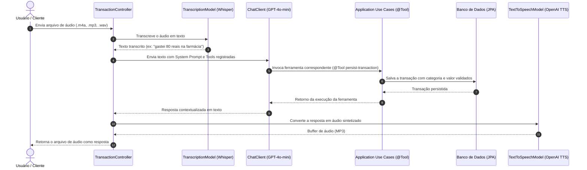

# 💰 Assistente Financeiro Inteligente com Spring AI

[](https://www.oracle.com/java/)
[](https://spring.io/projects/spring-boot)
[](https://spring.io/projects/spring-ai)
[](LICENSE)

API inteligente de controle financeiro e orçamento pessoal que integra o **Spring Boot** ao ecossistema do **Spring AI**. A aplicação é capaz de processar comandos de voz e texto, interpretar a intenção do usuário, invocar regras de negócio e persistência via **Tool Calling** (chamada de funções) e responder tanto em formato de áudio sintético (TTS) quanto em dados estruturados (JSON).

Projeto desenvolvido com base no desafio prático da trilha Spring Boot da [Digital Innovation One (DIO)](https://github.com/digitalinnovationone/dio-spring-boot-learning-track), evoluído com novas ferramentas, validações de domínio, testes automatizados e arquitetura em camadas.

---

## 🎯 Fluxo de Funcionamento com IA

O ciclo completo de processamento de voz segue as seguintes etapas:



---

## 🏗️ Arquitetura do Projeto

O projeto adota os princípios de **Clean Architecture** e **DDD**, garantindo baixo acoplamento entre regras de negócio e frameworks externos:

```text
src/main/java/dio/budgeting/
├── application/                    # Casos de uso e ferramentas (@Tool)
│   ├── input/                      # DTOs de entrada dos use cases
│   ├── output/                     # DTOs de saída dos use cases
│   ├── GetBalanceSummaryUseCase.java
│   ├── ListAllTransactionsUseCase.java
│   ├── ListTransactionsByCategoryUseCase.java
│   └── PersistTransactionUseCase.java
├── domain/                         # Núcleo de domínio (regras puras)
│   ├── Category.java               # Enum com categorias e descrições
│   ├── Transaction.java            # Entidade de domínio com validações
│   ├── TransactionId.java          # Value Object (UUID)
│   └── TransactionRepository.java  # Contrato do repositório
└── infrastructure/                 # Adaptadores e detalhes técnicos
    ├── http/                       # Controllers REST, DTOs e Exception Handler
    │   ├── exception/              # Tratamento global de erros
    │   ├── request/                # DTOs de requisição REST
    │   ├── response/               # DTOs de resposta REST
    │   └── TransactionController.java
    └── persistence/                # Implementação JPA e entidades
        ├── entity/                 # Entidades relacionais
        └── repository/             # Spring Data JPA e adaptadores
```

---

## 🛠️ Tecnologias Utilizadas

- **Java 25**
- **Spring Boot 4**
- **Spring AI (v2.0)**:
  - `ChatClient` com suporte a Tool Calling
  - `TranscriptionModel` (OpenAI Whisper)
  - `TextToSpeechModel` (OpenAI TTS)
- **Spring Data JPA** & **Hibernate**
- **H2 Database** (para execução e testes imediatos sem dependências)
- **MySQL 9** (suporte via Docker Compose)
- **Lombok**
- **JUnit 5**, **AssertJ** e **Mockito**

---

## 🚀 Como Executar

### Pré-requisitos
- JDK 25 instalado
- Uma chave de API da OpenAI (`OPENAI_API_KEY`) caso deseje testar as chamadas reais aos modelos

### 1. Clonar o repositório
```bash
git clone https://github.com/SEU-USUARIO/dio-spring-ai-budgeting.git
cd dio-spring-ai-budgeting
```

### 2. Configurar a chave de API (opcional para testes unitários)
No terminal (PowerShell no Windows):
```powershell
$env:OPENAI_API_KEY="sk-proj-sua-chave-aqui"
```

No Linux/macOS:
```bash
export OPENAI_API_KEY="sk-proj-sua-chave-aqui"
```

> **Nota:** Se a variável não for informada, a aplicação sobe normalmente com a chave padrão de mock para testes e endpoints REST manuais.

### 3. Rodar a aplicação
O projeto já está pré-configurado com **banco H2 em memória**, permitindo rodar imediatamente sem precisar de banco externo:

```bash
./gradlew bootRun
```

*(No Windows cmd/powershell: `.\gradlew.bat bootRun`)*

A aplicação estará disponível em `http://localhost:8080`.

#### (Opcional) Executar com MySQL via Docker Compose
Se preferir usar o banco MySQL:
```bash
docker compose up -d
./gradlew bootRun --args='--spring.profiles.active=mysql'
```

---

## 📡 Endpoints da API

### 1. Processar comando de voz (Áudio ➔ IA ➔ Ação ➔ Áudio)
Envia um áudio e recebe a resposta falada em formato MP3:
```bash
curl -X POST "http://localhost:8080/transactions/ai" \
  -H "Content-Type: multipart/form-data" \
  -F "file=@src/test/resources/audio/recording-1.m4a" \
  --output resposta.mp3
```

### 2. Chat em texto com o assistente inteligente
Interage com a IA via texto, disparando as mesmas ferramentas e retornando JSON:
```bash
curl -X POST "http://localhost:8080/transactions/ai/chat" \
  -H "Content-Type: application/json" \
  -d '{"message": "Gastei 150 reais no mercado fazendo compras da semana"}'
```

```bash
curl -X POST "http://localhost:8080/transactions/ai/chat" \
  -H "Content-Type: application/json" \
  -d '{"message": "Quanto eu já gastei até agora e qual foi a categoria mais cara?"}'
```

### 3. Obter resumo financeiro consolidado
```bash
curl -X GET "http://localhost:8080/transactions/summary"
```
**Exemplo de Resposta:**
```json
{
  "totalAmount": 230.0,
  "totalTransactions": 2,
  "categoryBreakdown": {
    "GROCERIES": 150.0,
    "PHARMA": 80.0
  },
  "highestExpenseCategory": "GROCERIES"
}
```

### 4. Listar todas as transações
```bash
curl -X GET "http://localhost:8080/transactions"
```

### 5. Consultar transações por categoria
Categorias disponíveis: `GROCERIES`, `PHARMA`, `AUTO`, `LEISURE`, `UTILITIES`, `EDUCATION`, `OTHER`.
```bash
curl -X GET "http://localhost:8080/transactions/GROCERIES"
```

### 6. Criar transação manualmente (REST)
```bash
curl -X POST "http://localhost:8080/transactions" \
  -H "Content-Type: application/json" \
  -d '{
    "description": "Tanque cheio de gasolina",
    "category": "AUTO",
    "amount": 220
  }'
```

---

## 🧪 Testes Automatizados

O projeto conta com testes unitários cobrindo regras de negócio, use cases e endpoints HTTP, além de testes de integração com os modelos da OpenAI:

Executar a suíte de testes:
```bash
./gradlew test
```

> Os testes de integração reais (`ToolCallingIT`, `OpenAiTranscriptionModelIT`, etc.) usam arquivos de áudio reais localizados em `src/test/resources/audio/` e são ativados automaticamente quando a variável de ambiente `OPENAI_API_KEY` estiver preenchida.

---

## 💡 Evoluções Implementadas em Relação à Base

1. **Novas ferramentas de IA via Tool Calling:**
   - `get-balance-summary`: cálculo em tempo real do total gasto e divisão por categorias.
   - `list-all-transactions`: listagem completa de transações acessível pelo agente.
2. **Endpoint de Chat em Texto (`/transactions/ai/chat`):** permite testar e integrar com facilidade sem depender de microfone.
3. **Validações e Tratamento de Erros:** validação de valores positivos, descrições não vazias e `GlobalExceptionHandler` padronizando respostas de erro em JSON.
4. **Suporte H2 + MySQL:** inicialização imediata com banco em memória sem dependência obrigatória de containers para rodar.
5. **Categorização Enriquecida:** descrições detalhadas nas categorias para orientar o modelo de linguagem na classificação contextual dos gastos.
6. **Suíte Completa de Testes:** testes com Mockito, AssertJ e MockMvc.

---

## 📄 Licença

Este projeto é distribuído sob a licença [MIT](LICENSE).
