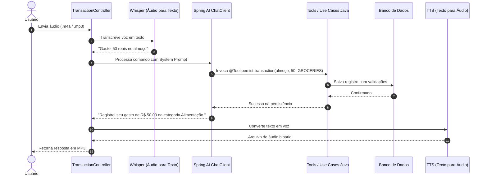

# 💰 Assistente Financeiro Inteligente com Spring AI

[](https://www.oracle.com/java/)
[](https://spring.io/projects/spring-boot)
[](https://spring.io/projects/spring-ai)
[](LICENSE)

Projeto desenvolvido para o desafio prático de **Spring Boot com Spring AI** da trilha backend da [Digital Innovation One (DIO)](https://github.com/digitalinnovationone/dio-spring-boot-learning-track).

---

## 📌 O que o projeto faz

Esta aplicação é uma **API de controle financeiro pessoal** que integra Inteligência Artificial Generativa para processar comandos de voz e texto. 

Em vez de apenas responder perguntas de forma genérica, o sistema conecta a IA às regras de negócio e ao banco de dados da aplicação por meio de **Tool Calling** (chamada de métodos Java pelo modelo).

### Fluxo ponta a ponta:
1. O usuário envia um arquivo de áudio (ex: gravado no celular dizendo *"gastei 85 reais no supermercado comprando frutas"*);
2. A API recebe o áudio e transcreve a fala em texto via **OpenAI Whisper**;
3. O modelo de linguagem (**GPT-4o-mini**) analisa o texto, identifica a intenção e os valores, escolhe a categoria adequada e aciona a ferramenta Java correspondente (`persist-transaction`);
4. A aplicação valida e salva a transação no banco de dados via JPA;
5. A IA gera uma mensagem de confirmação contextualizada;
6. O texto de retorno é convertido em fala (**OpenAI TTS**) e entregue de volta ao usuário como um arquivo de áudio `.mp3`.

Também está disponível um canal de chat em texto (`POST /transactions/ai/chat`) para interação rápida via JSON, além dos endpoints REST convencionais.



---

## 🚀 Como executar a aplicação

### Pré-requisitos
- **Java 25** instalado.
- Chave de API da OpenAI (`OPENAI_API_KEY`) para usar os modelos de IA reais (transcrição, chat e voz).

### 1. Obter o código
```bash
git clone https://github.com/SEU-USUARIO/dio-spring-ai-budgeting.git
cd dio-spring-ai-budgeting
```

### 2. Configurar a chave de API da OpenAI
Defina a variável de ambiente no seu terminal:

- **Windows (PowerShell):**
  ```powershell
  $env:OPENAI_API_KEY="sk-proj-sua-chave-aqui"
  ```
- **Linux / macOS:**
  ```bash
  export OPENAI_API_KEY="sk-proj-sua-chave-aqui"
  ```

> Caso não defina a chave, a aplicação subirá normalmente com uma chave de fallback, permitindo rodar a suíte de testes unitários e testar os endpoints REST manuais.

### 3. Executar o projeto
O projeto já vem configurado com **banco H2 em memória por padrão**, portanto você não precisa instalar ou subir nenhum banco externo para começar:

```bash
./gradlew bootRun
```
*(No Windows PowerShell: `.\gradlew.bat bootRun`)*

A API estará rodando em `http://localhost:8080`.

#### (Opcional) Executar com MySQL via Docker Compose
Se preferir rodar com banco MySQL persistente em container:
```bash
docker compose up -d
./gradlew bootRun --args='--spring.profiles.active=mysql'
```

---

## ⭐ Melhorias implementadas em relação à base

Para além da estrutura construída durante as aulas, foram adicionadas as seguintes evoluções:

1. **Novas ferramentas para o agente inteligente (Tool Calling):**
   - `get-balance-summary`: ferramenta Java que calcula em tempo real o valor total gasto, o número de lançamentos, o agrupamento financeiro por categoria e aponta a categoria com maior volume de gastos.
   - `list-all-transactions`: ferramenta que permite à IA consultar todo o histórico financeiro do usuário quando solicitada.

2. **Endpoint de Chat textual (`POST /transactions/ai/chat`):**
   - Permite conversar com a IA e acionar as ferramentas via JSON no Postman, cURL ou frontends web, sem obrigar o envio de arquivos de áudio em todos os testes.

3. **Validações e regras de negócio no Domínio:**
   - Validação de valores estritamente positivos (`amount > 0`) e descrição não vazia na entidade `Transaction`.
   - Criação de um `GlobalExceptionHandler` (`@RestControllerAdvice`) que captura erros de validação e argumentos ilegais, retornando respostas HTTP 400 com JSON claro e padronizado.

4. **Categorização semântica ampliada:**
   - Adicionadas categorias como `LEISURE` (lazer/restaurantes), `UTILITIES` (contas residenciais), `EDUCATION` e `OTHER`, com descrições semânticas em português para orientar o modelo na classificação correta.

5. **Suporte imediato a banco H2 em memória:**
   - Configuração de fallback para H2, garantindo que qualquer desenvolvedor clone o repositório e execute a aplicação ou os testes no primeiro comando, sem barreiras de infraestrutura.

6. **Cobertura completa de testes automatizados:**
   - Testes unitários com **Mockito** e **AssertJ** para todos os Use Cases.
   - Testes de integração HTTP com **MockMvc** validando status codes e tratamento de erros.

---

## 🛠️ Tecnologias utilizadas

- **Java 25 (LTS)**: versão mais recente com novos recursos da linguagem.
- **Spring Boot 4.0**: base do ecossistema do microsserviço.
- **Spring AI (v2.0)**:
  - `ChatClient`: cliente de alto nível para gerenciar mensagens e registrar ferramentas.
  - `TranscriptionModel`: integração com o **Whisper** para áudio-para-texto.
  - `TextToSpeechModel`: integração com **OpenAI TTS** para texto-para-fala.
  - `@Tool` e `@ToolParam`: mapeamento declarativo de use cases Java como funções para a LLM.
- **Spring Data JPA & Hibernate**: persistência relacional.
- **H2 Database**: banco em memória para desenvolvimento e testes ágeis.
- **MySQL 9**: suporte a banco relacional em produção.
- **Docker Compose**: orquestração do banco de dados local.
- **Lombok**: redução de boilerplate.
- **JUnit 5, AssertJ & Mockito**: suíte de testes unitários e de integração.
- **Gradle**: gerenciamento de dependências e build.

---

## 🧪 Como testar o fluxo principal

### 1. Testando via comando de voz (Áudio ➔ IA ➔ Áudio)
Envie um dos arquivos de teste já incluídos no projeto em `src/test/resources/audio/`:

```bash
curl -X POST "http://localhost:8080/transactions/ai" \
  -H "Content-Type: multipart/form-data" \
  -F "file=@src/test/resources/audio/recording-1.m4a" \
  --output resposta.mp3
```
*O arquivo `resposta.mp3` gerado conterá a voz da IA confirmando o registro da transação.*

### 2. Testando via texto com Tool Calling
Criar uma despesa via linguagem natural:
```bash
curl -X POST "http://localhost:8080/transactions/ai/chat" \
  -H "Content-Type: application/json" \
  -d '{"message": "Gastei 120 reais no restaurante italiano ontem à noite"}'
```

Consultar o balanço com a nova tool:
```bash
curl -X POST "http://localhost:8080/transactions/ai/chat" \
  -H "Content-Type: application/json" \
  -d '{"message": "Qual é o meu total de gastos até agora e qual categoria gastei mais?"}'
```

### 3. Consultar o resumo financeiro estruturado via REST
```bash
curl -X GET "http://localhost:8080/transactions/summary"
```

### 4. Rodar os testes automatizados
Para executar todos os testes da aplicação:
```bash
./gradlew test
```

---

## 🧠 O que aprendi durante o desafio

1. **Separação clara entre IA e Regras de Negócio:**
   Entendi na prática que a IA generativa não deve substituir a arquitetura da aplicação. O modelo atua como uma interface inteligente de interpretação e orquestração, enquanto as regras de negócio, cálculos e validações continuam isoladas nos casos de uso (`application`) e entidades (`domain`).

2. **Poder do Tool Calling (Function Calling):**
   Compreendi como transformar métodos Java comuns em ferramentas que a LLM decide quando e com quais parâmetros chamar. Isso resolve o problema de alucinação, pois o modelo delega ações reais para código determinístico.

3. **Pipelines Multimodais com Spring AI:**
   Foi muito enriquecedor ver o fluxo de ponta a ponta funcionando: entrada de áudio não estruturado (Whisper STT) ➔ processamento de linguagem natural e raciocínio (ChatClient) ➔ persistência em banco relacional ➔ resposta sintetizada em áudio de volta para o cliente (TTS).

4. **Resiliência e DX (Developer Experience):**
   A importância de planejar um projeto para que qualquer pessoa consiga rodar localmente sem fricção (usando H2 em memória como fallback e testes unitários com mocks que não dependem obrigatoriamente de créditos de API pagos para validar o build).

---

## 📄 Licença

Distribuído sob a licença [MIT](LICENSE).
